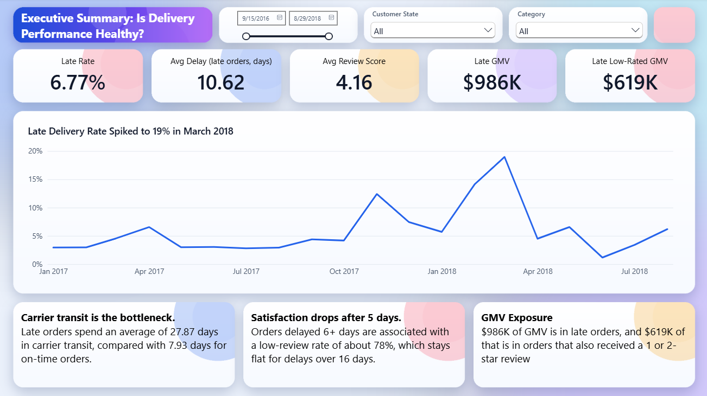
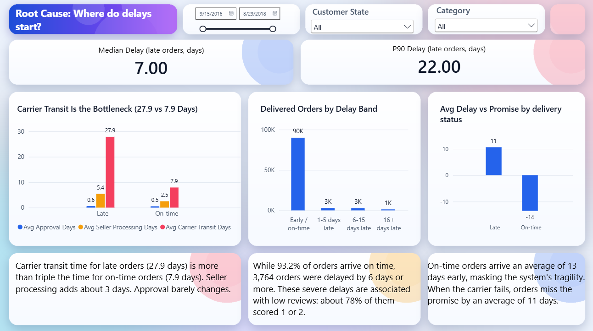
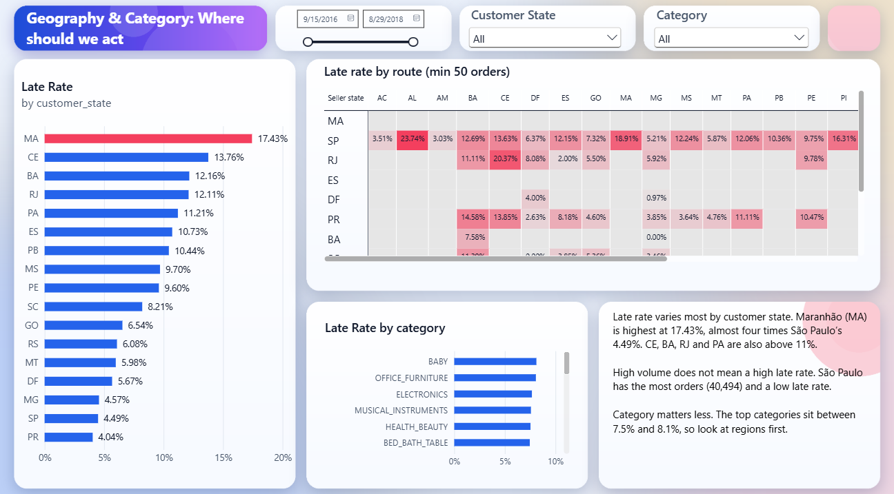
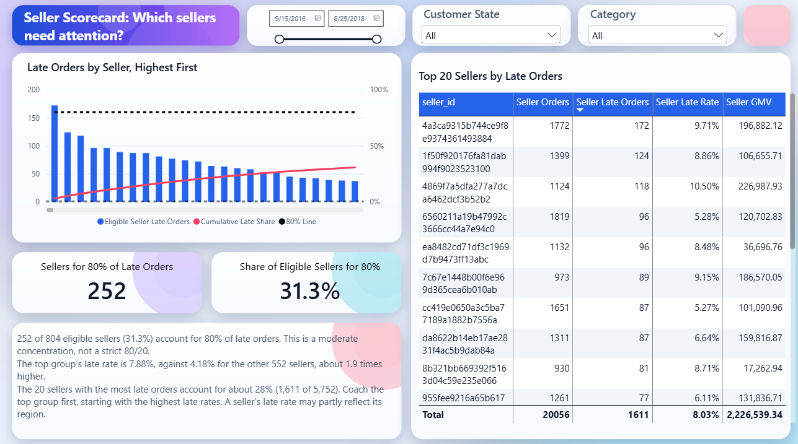
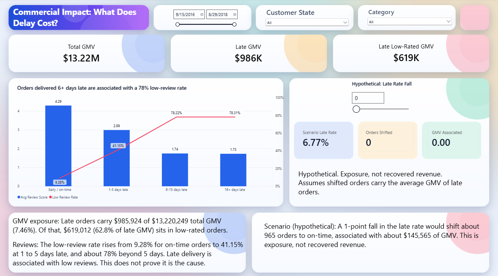

# Delivery Performance and Commercial Impact Analysis (Olist)

> Where should operations act first to reduce late deliveries and protect revenue?

An end-to-end analysis of 96,470 delivered orders from a Brazilian online marketplace. It links late shipping to bad reviews and exposed revenue, and ends in a five-page Power BI dashboard and three ranked recommendations.

**Tools:** SQL Server (T-SQL), Python (pandas, statsmodels, seaborn), Power BI
**Data:** [Olist Brazilian E-Commerce Public Dataset](https://www.kaggle.com/datasets/olistbr/brazilian-ecommerce) (Kaggle). Orders purchased 15 Sep 2016 to 29 Aug 2018. Amounts are in Brazilian reais (R$); the dashboard shows them with a $ sign.

## Dashboard

| Executive summary | Root cause |
|---|---|
|  |  |

| Geography and category | Seller scorecard |
|---|---|
|  |  |



Every page has global filters for date, customer state and category.

## Key findings

| Question | Finding |
|---|---|
| How big is the problem? | 6.77% of delivered orders are late (6,534 of 96,470). Late orders are on average 10.6 days late. |
| Where do delays start? | Carrier transit: 27.87 days for late orders against 7.93 for on-time orders. Seller processing differs by about 3 days. Approval barely differs. |
| How do delays relate to reviews? | The low-review rate (score 1 or 2) rises from 9.28% on time to 41.15% at 1 to 5 days late, and to about 78% beyond 5 days. |
| Who needs attention? | 252 of 804 sellers with 20+ orders (31.3%) account for 80% of late orders. Their late rate is 7.88% against 4.18% for the rest. |
| Where is it worst? | MA (17.43%), CE (13.76%), BA (12.16%), RJ (12.11%) and PA (11.21%), against 6.77% overall. Category differences are small. |
| What is exposed? | R$985,924 of GMV (7.46%) is in late orders. R$619,012 of it is in late, low-rated orders. This is exposure, not lost revenue. |

## Recommendations

| # | Action | Owner | Estimated impact (hypothetical) |
|---|---|---|---|
| 1 | Review carrier transit, starting with MA, CE, BA, RJ and PA | Logistics Manager | A 1-point fall in the late rate: about 965 fewer late orders, R$146K less exposure |
| 2 | Coach the 252 sellers behind 80% of late orders, highest late rate first | Seller Management | About 2,160 fewer late orders if they matched the other sellers |
| 3 | Contact customers the day an order passes its estimated date | Customer Experience Lead | 3,764 orders are 6+ days late with about 78% low reviews |

## Approach

```
Raw CSVs  ->  SQL Server bronze  ->  silver (clean, order level)  ->  gold (star schema)
                                                                         |
                                       SQL answers  +  Python statistics  +  Power BI
```

1. **Profile and load.** Profiled the 9 raw tables (rows, keys, nulls, ranges, join inflation) and loaded them as bronze tables.
2. **Clean.** Built `silver_orders` (one row per delivered order) and `silver_order_seller` (one row per order and seller). Items and payments were aggregated to order level before joining.
3. **Model.** Built a star schema of two fact views and three dimension views, so every slicer filters every visual.
4. **Analyse in SQL.** Answered four core and three supporting business questions with CTEs and window functions.
5. **Test in Python.** Two-proportion z-test, a logistic regression, a sensitivity check on the promise rule, and hypothetical scenarios.
6. **Visualise.** Five-page Power BI dashboard built on the gold views.

## Key decisions

| Decision | Choice and reason |
|---|---|
| Late order | Delivered date later than estimated date, compared as dates. 1,292 orders delivered on the due day were first flagged late because the estimated date is stored at midnight. They are now on time. The late rate changed from 8.1% to 6.77%. |
| Low review | Score of 1 or 2. Rates divide by reviewed orders only. |
| Order GMV | Item price only, aggregated to order level before any join. The BRD says price plus freight. Freight is a delivery charge, so it is kept in its own column. Including freight, total GMV is R$15.42M and late orders are still 7.46% of it (query Q4d). |
| Eligible seller | 20 or more orders. An order with two sellers counts once for each. |
| Category | Highest-priced item in the order. Orders with several categories count once. |
| Outliers | Kept. They are real orders and the focus of the severe-delay question. |
| Scenarios | 1, 2, 3 and 5 points. The BRD's 10 points would remove every late order, because the late rate is below 10%. |

## Data cleaning and quality checks

- Only delivered orders are used. 96,478 orders are delivered, and 8 of them have no delivery date, so 96,470 remain. Canceled, unavailable and other orders are context only.
- One review per order. 547 orders had several reviews. I kept the one with a comment, then the most recent. The raw data is never edited.
- Items are added up to order level before joining, because 99,441 orders become 112,650 rows when joined to items.
- No duplicate orders, customers, sellers, products or order items.
- 646 delivered orders (0.67%) have no review. They are left out of review rates only.
- Extreme delays are kept (the longest is 188 days), because they are real orders. A few timestamps are out of order (674 negative seller processing times, 0.70%), so stage averages carry a little noise.
- 96,470 orders in every layer, total GMV matching the source, and the late flag agreeing with delay days for every order.
- The notebook stops with an error if its totals do not match the SQL results.
- Allowing a 1, 2 or 3 day grace period does not change the conclusion.

## Repository structure

```
sql/        01_check_imported_data.sql, 02_profile_bronze.sql, 03_build_silver.sql,
            04_build_gold_views.sql, 05_analysis_final.sql
notebooks/  00_data_import.ipynb, 01_python_analysis.ipynb
dashboard/  Olist_Delivery_Dashboard.pbix
images/     dashboard screenshots
```

The raw CSVs are not included. Download them from Kaggle.

## How to reproduce

1. Download the dataset from Kaggle and run `notebooks/00_data_import.ipynb` to load the 9 CSVs as bronze tables.
2. Run `sql/01_check_imported_data.sql` and `sql/02_profile_bronze.sql` to check row counts and profile the data.
3. Run `sql/03_build_silver.sql` to create `silver_orders` and `silver_order_seller`. Its validation queries should show 96,470 orders and 6,534 late.
4. Run `sql/04_build_gold_views.sql` to create the star-schema views and run its validation checks.
5. Run `sql/05_analysis_final.sql` for the business-question results.
6. Run `notebooks/01_python_analysis.ipynb` top to bottom. Edit the server and database name in the first code cell.
7. Open the `.pbix` file, update the data source, and refresh.

## Limitations

- The data is from Brazil, 2016 to 2018. Treat the findings as a method, not current benchmarks.
- The estimated delivery date is treated as the promise made to the customer.
- Late delivery and low reviews are associated, not proven causal. Product quality and seller communication are not in the data.
- GMV exposure is not lost revenue. All scenarios are hypothetical.
- Customer and seller IDs are anonymised, so there is no repeat-purchase analysis.
- Item totals were not reconciled against payment values.

